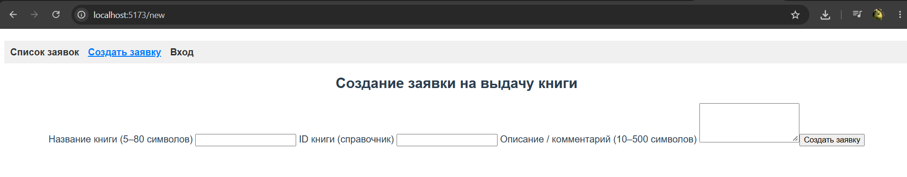
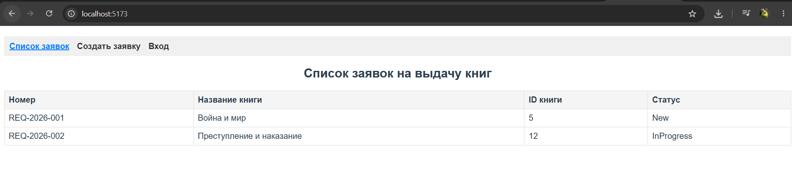
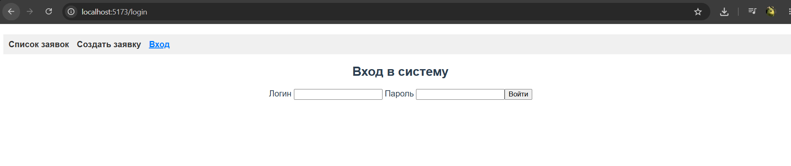

# Отчёт по лабораторной работе №4: Vue 3 - компоненты и маршруты

**Студент:** Чу Хоанг Лонг, группа ТРИС-1-23

**Проект:** АИС «БиблиоКонтроль» (МБУК «ЦБС» г. Казани)

Каркас приложения из лабораторной работы №3 декомпозирован на отдельные компоненты и страницы. Подключена библиотека
vue-router. Библиотека управления состоянием Pinia не используется, вместо неё применяется единый реактивный модуль.

## 1. Запуск проекта

`cd frontend`

`npm install`

`npm run dev`

Открыть адрес Vite, обычно http://localhost:5173.

## 2. Три адреса приложения

| Адрес  | Страница              | Что показывает                                    |
|--------|-----------------------|---------------------------------------------------|
| /      | pages/RequestList.vue | Список заявок на выдачу книг                      |
| /new   | pages/RequestNew.vue  | Форма создания заявки: title, bookId, description |
| /login | pages/Login.vue       | Форма входа: login, password                      |

Каждый адрес открывается вручную из адресной строки браузера и корректно отображается после перезагрузки страницы (F5).
Меню навигации реализовано с помощью ссылок router-link, старые кнопки с условием v-if полностью удалены.

Адрес /new является маршрутом Vue: он только отображает форму пользователю. Непосредственное создание записи в базе
данных будет выполнять будущий HTTP-запрос к серверу POST /api/requests (описан в docs/api-contract.md).

## 3. Скриншоты интерфейса

Скриншот страницы /new с видимой адресной строкой:



Остальные экраны:

Список заявок /: 


Страница входа /login: 


## 4. Дерево файлов frontend/src

```text
src/
├── main.js                  <-- подключает роутер: app.use(router)
├── App.vue                  <-- содержит AppHeader и router-view
├── router.js                <-- конфигурация трёх маршрутов
├── requestStore.js          <-- единственный общий реактивный массив заявок
├── assets/
│ └── main.css
├── components/
│ ├── AppHeader.vue        <-- шапка с меню из router-link
│ └── RequestTable.vue     <-- таблица, получает данные через props
└── pages/
├── RequestList.vue
├── RequestNew.vue
└── Login.vue
```

## 5. Соответствие имён курса и темы проекта

Согласно словарю из docs/data-model.md, абстрактные сущности курса адаптированы под предметную область библиотеки:
Ticket преобразован в Request (заявка), Site преобразован в Book (книга).

| Имя в методичке   | Имя в проекте      |
|-------------------|--------------------|
| ticketsStore.js   | requestStore.js    |
| TicketTable.vue   | RequestTable.vue   |
| TicketList.vue    | RequestList.vue    |
| TicketNew.vue     | RequestNew.vue     |
| Login.vue         | Login.vue          |
| siteId            | bookId             |
| POST /api/tickets | POST /api/requests |

## 6. Схема архитектуры компонентов

```text
App.vue
├── AppHeader                      <-- одна на всё приложение, не копируется в страницы
│ router-link: / /new /login
└── <main>
└── router-view              <-- сюда роутер подставляет страницу по текущему адресу
├── / --> RequestList --> RequestTable (:items=\"items\")
├── /new --> RequestNew
└── /login --> Login
```

Компонент шапки AppHeader расположен в App.vue снаружи элемента router-view. Благодаря этому при переходе между адресами
шапка остаётся на месте, а меняется только содержимое страницы внутри области router-view.

## 7. Владение данными

Массив заявок хранится исключительно в модуле requestStore.js. Страница RequestList.vue импортирует этот массив и
передаёт его в компонент таблицы следующим образом: <RequestTable :items=\"items\" />.

Компонент RequestTable.vue объявляет обязательный проп items, получает массив из requestStore.js и отрисовывает его.
Таблица не хранит собственную копию данных и не создаёт тестовый массив внутри себя, что гарантирует целостность данных
при переходе между страницами.

## 8. Чеклист выполнения требований

| Категория  | Требование                                                                 | Статус    |
|------------|----------------------------------------------------------------------------|-----------|
| Маршруты   | vue-router установлен (присутствует в package.json и package-lock.json)    | Выполнено |
| Маршруты   | Адреса /, /new, /login открываются вручную и после перезагрузки (F5)       | Выполнено |
| Маршруты   | Меню навигации реализовано через router-link                               | Выполнено |
| Маршруты   | Старые кнопки переключения экранов с v-if удалены                          | Выполнено |
| Компоненты | Созданы файлы AppHeader.vue, RequestTable.vue и три страницы в папке pages | Выполнено |
| Компоненты | Шапка не пропадает при навигации между маршрутами                          | Выполнено |
| Данные     | Таблица объявляет обязательный prop items и не хранит копию массива        | Выполнено |
| Данные     | Единственный источник массива данных находится в requestStore.js           | Выполнено |
| Данные     | Библиотека Pinia не используется                                           | Выполнено |
| Git        | Файлы package.json и package-lock.json добавлены в коммит                  | Выполнено |
| Git        | Папка node_modules исключена из отслеживания Git                           | Выполнено |
